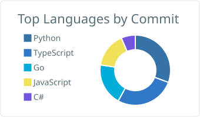
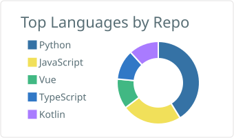
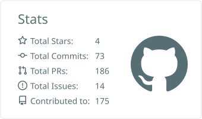
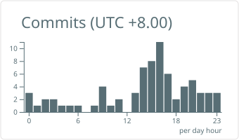

<a href="https://github.com/Huang-404-Q">
  <picture>
    <source media="(prefers-color-scheme: dark)" srcset="https://readme-typing-svg.demolab.com?font=Fira+Code&weight=600&size=24&duration=2500&pause=900&color=1D4ED8&center=true&vCenter=true&width=620&lines=%F0%9F%A4%96+Building+Agents+on+Android%2C+Web+and+CLI;%F0%9F%94%A7+53+merged+PRs+across+28+open-source+repos;%F0%9F%9A%80+Talk+is+cheap%2C+show+me+the+code!"/>
    
  </picture>
</a>

  
  
  

## 🎯 About Me

<table>
  <tr><td>&nbsp; &nbsp; <a href="https://www.hrbeu.edu.cn"><b>哈尔滨工程大学</b></a> · 硕士 · 2025 – 2028</td></tr>
  <tr><td>&nbsp; &nbsp; <a href="https://www.njupt.edu.cn"><b>南京邮电大学</b></a> · 本科 · 2021 – 2025</td></tr>
  <tr><td></td></tr>
  <tr><td>&nbsp; &nbsp; <a href="https://www.10jqka.com.cn"><b>同花顺</b></a> · 大模型算法实习生 · 2026.09 – 至今</td></tr>
  <tr><td>&nbsp; &nbsp; <a href="https://www.modelbest.cn"><b>面壁智能</b></a> · Agent 算法实习生 · 2026.04 – 2026.09</td></tr>
  <tr><td></td></tr>
  <tr><td><a href="mailto:13165998033@163.com"><b>13165998033@163.com</b></a> — 无论什么事都可以联系我，随时欢迎来信 💌</td></tr>
</table>

## 📘 Projects

<table>
<tr>
<td width="50%" valign="top">

#### 📱 [Oriona](https://github.com/Huang-404-Q/Oriona)

Android 原生执行型 Agent：本地记忆、受控的工具调用、自动化，以及多渠道消息投递。

  

</td>
<td width="50%" valign="top">

#### 🧠 [OrionAgent](https://github.com/Huang-404-Q/OrionAgent)

个人 AI 知识库与记忆助手：文档、图片、网页可语义检索，从对话中自动沉淀记忆。

  

</td>
</tr>
<tr>
<td width="50%" valign="top">

#### 🔨 [memory-forge](https://github.com/Huang-404-Q/memory-forge)

面向代码仓库的元 skill：把项目知识锻造成多个聚焦、可维护的 Claude Code skill。

  

</td>
<td width="50%" valign="top">

#### 🔀 [tiny-router](https://github.com/Huang-404-Q/tiny-router)

极简 Anthropic 兼容网关：Claude Code 只连本地，由模型决定请求路由到哪个上游。

  

</td>
</tr>
<tr>
<td width="50%" valign="top">

#### 🥊 [model-arena](https://github.com/Huang-404-Q/model-arena)

模型擂台：同一任务并行发给任意数量的模型，实时对比过程、结果与成本。

  

</td>
<td width="50%" valign="top">

#### 🌊 [mm-dataflow](https://github.com/Huang-404-Q/mm-dataflow)

配置驱动的多模态数据流水线：噪声由自己注入并带真值，算子的精确率和召回率可精确计算。

  

</td>
</tr>
</table>

## 🤝 Upstream Contributions

<table>
<tr>
<td align="center" width="20%"><a href="https://github.com/nodejs/node/pull/66886"> <b>node</b></a>&nbsp;·&nbsp;⭐123k 代码合并&nbsp;<b>1</b></td>
<td align="center" width="20%"><a href="https://github.com/microsoft/terminal/pull/20825"> <b>terminal</b></a>&nbsp;·&nbsp;⭐105k 代码合并&nbsp;<b>1</b></td>
<td align="center" width="20%"><a href="https://github.com/sveltejs/svelte/pull/19141"> <b>svelte</b></a>&nbsp;·&nbsp;⭐89k 代码合并&nbsp;<b>1</b></td>
<td align="center" width="20%"><a href="https://github.com/bytedance/deer-flow/pulls?q=is%3Apr+author%3AHuang-404-Q+is%3Amerged"> <b>deer‑flow</b></a>&nbsp;·&nbsp;⭐85k 代码合并&nbsp;<b>5</b></td>
<td align="center" width="20%"><a href="https://github.com/prometheus/prometheus/pull/20149"> <b>prometheus</b></a>&nbsp;·&nbsp;⭐67k 代码合并&nbsp;<b>2</b></td>
</tr>
<tr>
<td align="center" width="20%"><a href="https://github.com/sharkdp/bat/pull/4102"> <b>bat</b></a>&nbsp;·&nbsp;⭐61k 代码合并&nbsp;<b>1</b></td>
<td align="center" width="20%"><a href="https://github.com/mozilla/pdf.js/pull/22380"> <b>pdf.js</b></a>&nbsp;·&nbsp;⭐54k 代码合并&nbsp;<b>1</b></td>
<td align="center" width="20%"><a href="https://github.com/nushell/nushell/pull/19409"> <b>nushell</b></a>&nbsp;·&nbsp;⭐41k 代码合并&nbsp;<b>1</b></td>
<td align="center" width="20%"><a href="https://github.com/docker/compose/pull/14380"> <b>compose</b></a>&nbsp;·&nbsp;⭐39k 代码合并&nbsp;<b>1</b></td>
<td align="center" width="20%"><a href="https://github.com/can1357/oh-my-pi/pulls?q=is%3Apr+author%3AHuang-404-Q+is%3Amerged"> <b>oh‑my‑pi</b></a>&nbsp;·&nbsp;⭐38k 代码合并&nbsp;<b>7</b></td>
</tr>
<tr>
<td align="center" width="20%"><a href="https://github.com/jqlang/jq/pull/3694"> <b>jq</b></a>&nbsp;·&nbsp;⭐36k 代码合并&nbsp;<b>1</b></td>
<td align="center" width="20%"><a href="https://github.com/atuinsh/atuin/pull/4456"> <b>atuin</b></a>&nbsp;·&nbsp;⭐32k 代码合并&nbsp;<b>1</b></td>
<td align="center" width="20%"><a href="https://github.com/LearningCircuit/local-deep-research/pulls?q=is%3Apr+author%3AHuang-404-Q+is%3Amerged"> <b>local‑deep‑research</b></a>&nbsp;·&nbsp;⭐9k 代码合并&nbsp;<b>6</b></td>
<td align="center" width="20%"><a href="https://github.com/maximhq/bifrost/pull/7027"> <b>bifrost</b></a>&nbsp;·&nbsp;⭐9k 代码合并&nbsp;<b>2</b></td>
<td align="center" width="20%"><a href="https://github.com/google/adk-go/pull/1551"> <b>adk‑go</b></a>&nbsp;·&nbsp;⭐9k 代码合并&nbsp;<b>1</b></td>
</tr>
</table>

代码合并 <b>53</b> · 覆盖 <b>28</b> 个上游仓库

📌 挑几个说说（都是线上真会出事的那种）

- **prometheus/prometheus** · [截断后 head chunk 文件编号保持单调递增](https://github.com/prometheus/prometheus/pull/20149)
  重启后如果在还没写入新 chunk 的空窗期触发截断，序号会归零、下一个文件又从 `000001` 开始，新样本的引用低于 OOO 书签，查询路径直接忽略、GC 再清一遍——数据**静默丢失**。

- **mozilla/pdf.js** · [读 32 位函数采样时改用无符号移位](https://github.com/mozilla/pdf.js/pull/22380)
  32 位累加器用算术移位，最高位为 1 时整段采样读成负数再被钳到 0：`0x80000000` 本该是 0.5 却解码成 0，整条 PDF 函数曲线是错的。

- **maximhq/bifrost** · [在故障转移边界清掉上游响应头](https://github.com/maximhq/bifrost/pull/7021)
  LLM 网关回退到 B 却把 A 的 `Retry-After` 和限流头原样转发，客户端按一个**从没服务过它的 provider** 的限额去等待，而且从响应本身无法察觉。

- **LearningCircuit/local-deep-research** · [删除报告时拒绝软链接和越界路径](https://github.com/LearningCircuit/local-deep-research/pull/6473)
  旧实现先 resolve 再 unlink，根目录内一个指向外部的软链接会**删掉根外的文件**；改成按给定路径删除、用解析后的位置判断越界，并把检查和删除合成一步。

- **nodejs/node** · [标记 session 销毁前先清掉超时](https://github.com/nodejs/node/pull/66886)
  `setTimeout(0)` 在已销毁的 session 上提前返回，空闲定时器继续持有 session 到 30 秒超时才放——连接已关但资源不释放。

- **google/adk-go** · [状态写库时不再吞掉 JSON 序列化错误](https://github.com/google/adk-go/pull/1551)
  `GormValuer` 路径写的是 `data, _ := json.Marshal(...)`，`NaN` 这类值被序列化成空 payload **静默写进库**，错误通道形同虚设。

## 🛠️ Technical Arsenal

<table border="0">
<tr>
<td align="right"><b>语言</b></td>
<td></td>
</tr>
<tr>
<td align="right"><b>Agent & AI</b></td>
<td></td>
</tr>
<tr>
<td align="right"><b>前端 & 移动端</b></td>
<td></td>
</tr>
<tr>
<td align="right"><b>基础设施</b></td>
<td></td>
</tr>
</table>

## 📊 GitHub Analytics

<picture>
  <source media="(prefers-color-scheme: dark)" srcset="https://raw.githubusercontent.com/Huang-404-Q/Huang-404-Q/output/github-snake-dark.svg"/>
  <source media="(prefers-color-scheme: light)" srcset="https://raw.githubusercontent.com/Huang-404-Q/Huang-404-Q/output/github-snake.svg"/>
  
</picture>

